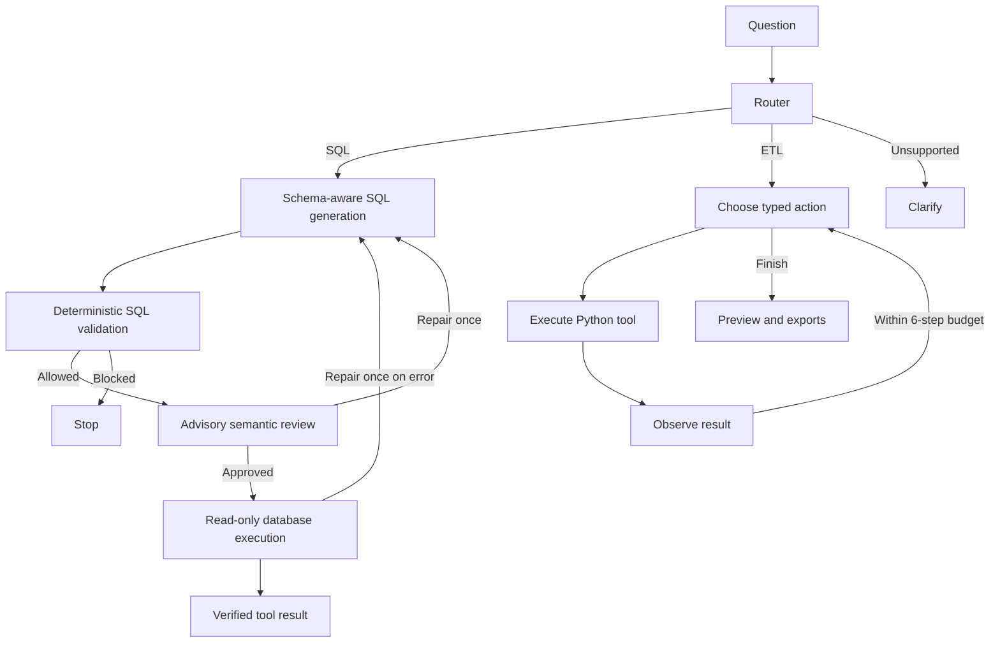

# Ola Data Agent / RideOps

[](https://github.com/b-amit11/ola-data-agent/actions/workflows/ci.yml)

A LangGraph data agent for ride-booking analytics: it routes a plain-English request to a SQL analyst or a Python ETL workflow, runs it against a read-only database, and shows every step so the resulting tables and exports can be verified.

**Stack:** Python · LangGraph · LangChain · Groq · Pydantic · SQLAlchemy · PostgreSQL · SQLite · Pandas · Streamlit · Docker · pytest · GitHub Actions

**Highlights**
- Model output never runs directly: SQL is validated, then executed through a **SELECT-only PostgreSQL role** that the database itself enforces.
- Bounded agent loops: at most one SQL repair, fixed step budgets, 30 s timeouts, no hidden fallbacks.
- **43 tests** plus 15 evaluation checks per backend, with answers verified against independent Pandas calculations. CI runs both SQLite and PostgreSQL.

**Attribution:** the core workflow is inspired by Ansh Lamba’s [Build Ola AI Data Agent](https://www.youtube.com/watch?v=7yOmi4IX-Rs) and the accompanying [AI_Data_Agent repository](https://github.com/anshlambagit/AI_Data_Agent). This is an independent implementation with deliberate differences (see [Differences from the tutorial](#differences-from-the-tutorial)). It is not affiliated with Ola and is not a novel-agent-architecture claim.

## What works

- **SQL analyst:** schema-aware query generation, deterministic validation, an advisory semantic reviewer, read-only execution, one bounded repair and tabular results.
- **Python ETL analyst:** a bounded action–tool–observation loop with inspection, filtering, aggregation, named API extraction and CSV/JSON export.
- **Router:** chooses SQL, ETL or clarification using validated structured responses.
- **Interface:** mode selection, backend selection, SQL inspection, result chart/table, export downloads, schema explorer, evaluation and execution traces.
- **Backends:** a portable SQLite demo and a PostgreSQL Docker service with a SELECT-only application role.

## Two modes—different evidence

| Mode | Planning | Tool execution | API key |
|---|---|---|---|
| Offline demo | Handwritten plans for 10 listed examples | Real database queries and Pandas transformations | None |
| Live LLM | LangChain + Groq structured responses, orchestrated by LangGraph | Same validated database and ETL tools | Required |

Offline success is **not LLM accuracy**. Live smoke checks verified a city-revenue query and a 366-row filtered export using Groq. The complete live suite remains unvalidated because of output-contract differences and rate limits. No hidden fallback substitutes a fixture answer if a live call fails. The app reports results directly from tools instead of asking an LLM to invent a narrative around them.

## Run locally

Use Python 3.12 or newer:

```bash
python3 -m venv .venv
source .venv/bin/activate
pip install -r requirements.txt
python -m ola_agent.seed
python -m ola_agent.evaluate
streamlit run app.py --server.port 8502
```

Open http://localhost:8502. Select **Offline demo**, choose an example, and click **Run workflow**. The macOS `Start Demo.command` launcher also works once an environment exists. `requirements-lock.txt` records the local tested environment; `requirements.txt` is the portable supported range specification.

Example requests:

- “Show collected revenue by city.”
- “What is the cancellation rate by city?”
- “Who are the top 5 riders by collected revenue?”
- “Export completed rides longer than 20 km as JSON.”
- “Count completed rides by city and export CSV.”

## Use PostgreSQL

With Docker Desktop running, from this directory:

```bash
docker compose up -d --wait
python -m ola_agent.evaluate --postgres
```

Choose **PostgreSQL (local Docker)** in the app. The database binds only to `127.0.0.1:5433` and is seeded from the included synthetic CSV files on first initialization. Demo passwords in `compose.yaml` and `postgres/init.sql` are intentionally public, local-development credentials for synthetic data only. Do not reuse them for other databases or public hosting.

To stop the project container without deleting its database volume:

```bash
docker compose stop
```

The optional app container can be built and launched with:

```bash
docker compose --profile app up -d --build
```

The containerized interface uses http://localhost:8503; select PostgreSQL to use its sibling database service. The Python 3.12 app image was built and its health endpoint checked; all 15 offline evaluation checks also passed inside the container against PostgreSQL.

## Enable live LLM mode

Create an API account and key through [Groq Console](https://console.groq.com/keys). Check your account’s available models, limits and pricing before use; this project does not assume unlimited free usage.

```bash
cp .env.example .env
```

Edit `.env` locally:

```dotenv
GROQ_API_KEY=your_actual_key_here
GROQ_MODEL=qwen/qwen3.8-27b
```

Never paste the real key into chat, source code, screenshots or GitHub. `.env` is ignored by Git and excluded from Docker build context. Restart the app, select **Live LLM**, and ask your own question. The configured provider receives the question, schema and tool observations from the synthetic dataset. Model availability can change; adjust `GROQ_MODEL` if needed to a model supporting JSON output.

Run the developer-authored live evaluation once configured:

```bash
python -m ola_agent.evaluate --live
# Optional PostgreSQL backend:
python -m ola_agent.evaluate --live --postgres
```

This makes real API calls. SQL workflows use at most five model calls per request; ETL uses at most seven. API timeouts are 30 seconds per call and provider retries are disabled. The evaluation uses strict expected table shapes, column names, ordering and numerical tolerances; failures can reflect output-contract differences as well as wrong answers. It is not a held-out benchmark.

## Dataset and business definitions

All ride data was generated by this project with seed 42. It contains **1,200 rides, 250 users, 80 vehicles, 940 payments and 940 ratings**, over January–March 2026, across five Indian cities. There are no real customer records. Synthetic patterns do not support business conclusions about Ola.

Collected revenue is the sum of **Captured** payments joined to **Completed** rides. Quoted fare is not necessarily collected revenue. Cancellation rate divides cancelled rides by all rides. Ride city is distinct from a user’s signup city. These definitions are provided to the live model and checked by separate calculations.

The optional extraction source is the fixed [PokeAPI Pokemon list endpoint](https://pokeapi.co/api/v2/pokemon?limit=20), matching the tutorial’s extraction concept. Offline mode uses an explicitly handwritten three-record fixture; it does not claim to have fetched the API. Live mode requests 20 records. A development smoke test received HTTP 403 from this endpoint, so successful live extraction remains unverified. No arbitrary URLs, local network destinations or model-specified file paths are supported.

## Verification

```bash
python -m pytest -q
TEST_POSTGRES=1 python -m pytest -q
python -m ola_agent.evaluate
python -m ola_agent.evaluate --postgres
```

The offline evaluation checks 10 workflows and five blocked queries. Both database backends passed all 15 checks during local development, and all 43 tests passed with PostgreSQL enabled. SQL answers and transformation outputs are checked against independent Pandas calculations. Tests cover SQL writes, multiple statements, schema access, dangerous functions, independent read-only enforcement, row caps, invalid columns, atomic filters, export paths, retries, step budgets, cross-run isolation, provider contracts and app interaction. The PostgreSQL permission test is opt-in; default CI skips it.

Reports live in `reports/evaluation.json` and `reports/evaluation-postgres.json`. A CI workflow is provided; a successful local run is not a claim that remote GitHub Actions has run.

## Architecture



`ola_agent/graph.py` defines the graph; `provider.py` separates real models from demo fixtures; `schemas.py` defines model response contracts; `database.py` enforces query constraints; `etl.py` implements Python tools; `evaluate.py` supplies independent result checks; `app.py` provides the interface.

## Differences from the tutorial

The reference uses model-generated Python execution, arbitrary API extraction inputs and several model providers. This implementation uses a fixed tool vocabulary, a named extraction source, one configurable Groq provider, database-enforced read-only access and explicit execution budgets. API endpoints and Python programs are not generated and executed by the model. This narrows flexibility deliberately and is not a feature-for-feature reproduction.

No source code or ride dataset was copied from the reference repository. The source was inspected to understand its architecture and identify implementation choices. Tutorial credit is retained.

## Limitations and next steps

- Live smoke checks with `qwen/qwen3.8-27b` returned correct city revenue totals and exported 366 completed rides longer than 20 km; the export was compared against an independent Pandas filter. The nine-case live suite did not pass: strict output contracts rejected some results and provider rate limits interrupted others. This is not a validated accuracy benchmark.
- Synthetic data makes testing reproducible but does not establish performance on messy production schemas.
- The semantic reviewer uses the same model as the generator; it is not an independent judge of truth.
- Guardrails narrow execution, but they are not a formal security proof or a multi-tenant isolation boundary.
- Returned rows are capped at 100. An aggregate query can still summarize all source rows; a truncated detail table must not be mistaken for a complete dataset.
- No authentication, production deployment, user adoption, cost benchmark or measured business impact is claimed.
- Future work: held-out question sets and paraphrases, real-model evaluation, schema-change tests, token/cost telemetry, and a separately reviewed deployment configuration.
